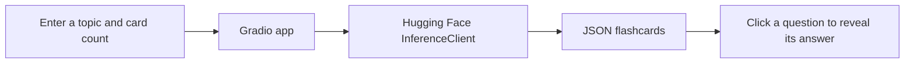

<div align="center">
  
</div>

<div align="center">
  <a href="https://www.python.org/"></a>
  <a href="https://www.gradio.app/"></a>
  <a href="https://huggingface.co/docs/inference-providers/en/index"></a>
</div>

<h1 align="center">Flashcard Generator with Hugging Face</h1>

<p align="center">Turn a study topic into a set of clear, clickable question-and-answer cards.</p>

## ✨ What it does

- Generates **1–12 flashcards** from a topic you choose.
- Uses Hugging Face Inference Providers through `huggingface_hub.InferenceClient`.
- Shows each question as a card; click it to reveal the answer.
- Lets you choose another Hugging Face chat model in the app.
- Escapes generated text before rendering it in the page.

## 🧭 How it works



## 🚀 Get started

### 1. Create an environment and install packages

```bash
python -m venv .venv
```

Activate it, then install the requirements:

```powershell
# Windows PowerShell
.venv\Scripts\Activate.ps1
pip install -r requirements.txt
```

```bash
# macOS / Linux
source .venv/bin/activate
pip install -r requirements.txt
```

### 2. Set your Hugging Face token

Create a user access token with **Inference Providers** permission in [Hugging Face settings](https://huggingface.co/settings/tokens). Keep the token private and set it in your shell; never paste it into source files or commit it.

```powershell
# Windows PowerShell
$env:HF_TOKEN = "hf_your_token"
```

```bash
# macOS / Linux
export HF_TOKEN="hf_your_token"
```

### 3. Start the app

```bash
python app.py
```

Open the local URL printed by Gradio, enter a topic such as **Photosynthesis**, choose the number of cards, and click **Generate flashcards**.

## ⚙️ Configuration

| Setting | Required | Default | Description |
| --- | :---: | --- | --- |
| `HF_TOKEN` | Yes | — | Hugging Face token with Inference Providers permission. |
| `HF_MODEL` | No | `Qwen/Qwen2.5-7B-Instruct` | Default model ID. The model field in the app can override it. |

Model and provider availability, rate limits, and pricing can vary. Choose a chat model currently supported by Hugging Face Inference Providers.

## 🧪 Run tests

The tests use a mocked inference response, so they do not need a token or call a live model:

```bash
python -m unittest discover -s tests -v
```

## 🗂️ Project layout

```text
Flashcard-generator/
├── app.py                         # Gradio UI and Hugging Face inference call
├── requirements.txt               # App dependencies
├── tests/test_app.py              # Offline unit tests
└── assets/flashcard-generator-banner.svg
```

## 🔐 Token safety

The app reads `HF_TOKEN` from the environment. `.env` files and virtual environments are ignored by Git; do not publish access tokens.

---

<div align="center">Built with Python · Gradio · Hugging Face 🤗</div>

